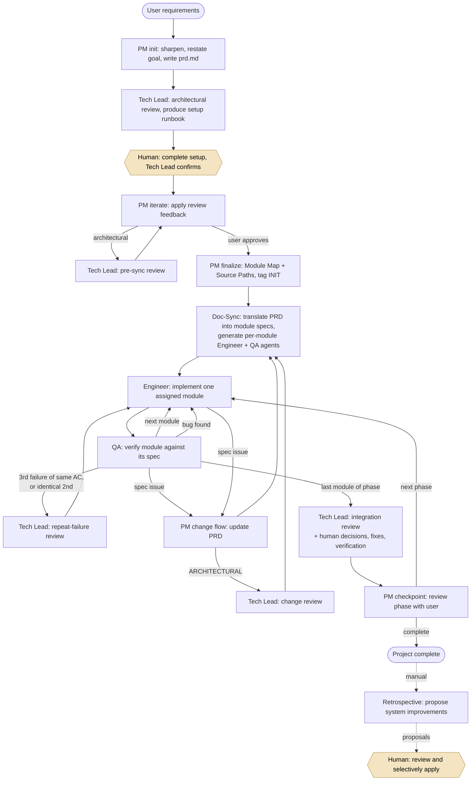

# Multi-Agent Software Development System

A team of six specialized AI agents that plan, build, and QA software through a
controlled, human-approved workflow. Each agent is a
[Claude Code](https://docs.claude.com/en/docs/claude-code) agent with a single
responsibility and its own fresh context, coordinating entirely through files on disk
— no shared memory, no black box. A coordinator runs the agents for you in one
conversation and stops for you at every decision.

**It produces real software.** This system designed, implemented, and QA'd
**[TabVault](https://tab-vault.com)**, a deployed full-stack tab/notes manager.
→ [TabVault repo](https://github.com/LeonWu813/tab-management)

---

## How it works

Each agent does one job, sees only the files its role needs, and commits its work
to git before stopping. The default Claude Code session acts as a **coordinator** in
**one-conversation mode**: it runs every framework agent for the human as a subagent,
reads the next step each agent records (`next:` in `status.md`, written as
`claude --agent <name> "<start word>"`, e.g. `claude --agent qa-mod-login "verify"`),
runs the pstack review steps (saved to `project-planning/pstack-findings/`) that Tech
Lead reads, and starts the next agent — but never edits an owned file itself, and no
agent starts another. A subagent can't ask the human anything, so the coordinator
stops at every decision: each PM change (PM first returns a proposal and its
questions, writing nothing; it applies the change only with the human's approval
quoted word for word), integration-review decisions, the human's own verification of
a fix, QA's UI sign-off, setup steps, and any agent's `needs-human` question. It
relays questions and answers verbatim and never decides for the human. A handoff hook
prints each step for the human too, noting whether the coordinator carries on or will
ask first. Running any agent directly (`claude --agent <name> "<start word>"`) still
works, under the same rules. Every handoff is an atomic git commit, so any step can be
rolled back cleanly, and every phase checkpoint is tagged `checkpoint-<N>`.



*The coordinator walks these arrows for you; the human decides at every gate — each
PM change, setup, integration-review decisions, fix verification, UI sign-off, and any
question an agent raises.*

---

## Design principles

The interesting engineering isn't the code the agents write — it's the system that
makes them produce correct software reliably. Four ideas do most of the work:

- **Single responsibility.** Each agent has one job, one input, one output, one
  handoff rule. Small, scoped agents are easier to constrain and to reason about, so
  a mistake stays contained.
- **Least-privilege information boundaries.** Each agent reads and writes only the
  files its role requires. The Engineer never sees the PRD; it sees its module spec,
  which carries forward just enough context. No agent sees everything.
- **Human in the loop at every decision.** The coordinator runs the routine steps;
  every decision is the human's, relayed word for word, and PM applies no change
  without the human's quoted approval.
- **Git as a rollback safety net.** Every handoff is an atomic commit, so any step
  is a clean point to revert to. Progressive-disclosure skills (lean router files
  that load detailed workflows only when needed) keep each agent's context
  token-efficient.

---

## The six agents

| Agent | Responsibility | Can write |
|-------|----------------|-----------|
| **PM** | Owns the PRD and all user communication | `prd.md`, its `status.md` sections, final `README.md` |
| **Doc-Sync** | Translates the PRD into downstream specs; generates per-module Engineer/QA agents | `production.md`, module specs and status files, generated agents |
| **Tech Lead** | Architectural advisory: feasibility, risks, setup runbook, phase-end integration review | `status.md` (reviews), `setup.md` and infrastructure files, `integration-review.md` |
| **Engineer** | Implements one assigned module | its module's Source Path, the root project files if its module owns them, its own module status |
| **QA** | Verifies one module against its spec | its module's QA results |
| **Retrospective** | Proposes system improvements from project history (manual only) | `retrospective/` proposals |

Engineer and QA are base templates (in `.claude/agent-templates/`); Doc-Sync generates
a thin per-module wrapper for each (`engineer-mod-<name>`, `qa-mod-<name>`), hard-coding
which module spec, Source Path, and dependencies that instance may use. Source Paths
(folders, files, or filename patterns such as `supabase/migrations/*_mod_003_*`)
never overlap, and one module owns the root project files (manifests, lockfiles,
`.env.example`, CI config). A `PreToolUse` hook enforces each agent's skill allowlist
(framework agents other than Doc-Sync may also use the project's own `.claude/skills/`), keeps each Engineer's writes inside its module's scope (the same rules `self-check.sh`
uses), lets only PM change the Module Map, and blocks every agent from writing under
`~/.claude`. Shell writes never pass through that hook, so the handoff hook re-runs the
scope check whenever an Engineer stops: any file outside the module's scope replaces the
next step with a "Scope violation … Fix first" message that sends the Engineer back in
`scope-fix` mode to undo exactly those changes; once the scope is clean, the hook itself
routes back to the step that was interrupted. The check does not trust commit messages:
the handoff hook records a base commit at every stop where HEAD moved, and an Engineer's
changes are everything since the last base someone else recorded. Every agent commit
still carries its role prefix (`engineer-mod-login(implement): …`) so the history reads
clearly; the coordinator's own commits start `coordinator(<what>): …` and the human's
manual commits `human: …`, and files changed only by those two are left out of the check.

---

## Run it

```bash
# Install agents, base templates, skills, and hooks
mkdir -p ~/.claude/agents ~/.claude/agent-templates ~/.claude/skills ~/.claude/hooks
cp -r .claude/agents/.          ~/.claude/agents/
cp -r .claude/agent-templates/. ~/.claude/agent-templates/
cp -r .claude/skills/.          ~/.claude/skills/
cp -r .claude/hooks/.           ~/.claude/hooks/
chmod +x ~/.claude/hooks/*.sh
# Merge the entries in .claude/hooks/settings-hooks.json into the "hooks" key of
# ~/.claude/settings.json (Claude Code does not load a standalone hooks.json)
# This registers handoff.sh (next-step messages and the Engineer scope re-check, on
# Stop/SubagentStop) and pstack-guard.sh (on PreToolUse: skill allowlists, Engineer write
# scope, Module Map and ~/.claude protection, read-only pstack reviewers). Both need jq
# and python3. Optional: install the pstack plugin for the review steps listed under
# "Required pstack steps" in the scaffolded CLAUDE.md.

# Start a new project (PM's init scaffolds project-planning/ and CLAUDE.md, and runs
# git init if the folder is not a repository yet)
cd ~/projects/my-new-app
claude --agent pm
```

From there, open the default session (`claude`) in the project folder: the scaffolded
`CLAUDE.md` makes it the coordinator, which runs each agent as a subagent and stops
whenever it needs your decision. You can still run any agent yourself with the command
the hook prints. If Doc-Sync generates new per-module agents and the coordinator can't
find them yet, run `claude --continue` in the folder — it reopens the same conversation
with the new agents loaded.

---

## Repo structure

```
.claude/
├── agents/           # PM, Doc-Sync, Tech Lead, Retrospective (+ generated per-module wrappers in each project)
├── agent-templates/  # Engineer and QA base templates Doc-Sync builds the wrappers from
├── skills/           # Reusable knowledge: router SKILL.md + workflows/references/templates/scripts
└── hooks/            # handoff.sh (next command, Engineer scope re-check), pstack-guard.sh (allowlists, write scope, Module Map), settings-hooks.json
ARCHITECTURE.md  # Full design spec — the deep dive
```

For the complete design — every agent's constraints, the skill architecture, the
sync rulebook, and the git/rollback conventions — see **[ARCHITECTURE.md](./ARCHITECTURE.md)**.

---

## Status

<!-- Be honest here — this section backs your "did you really build this?" answer.
     Edit to match what's actually running vs. specified. Example below. -->

The six agent definitions, skills, and handoff hooks are implemented and were used
end to end to build [TabVault](https://tab-vault.com). And more going on~
